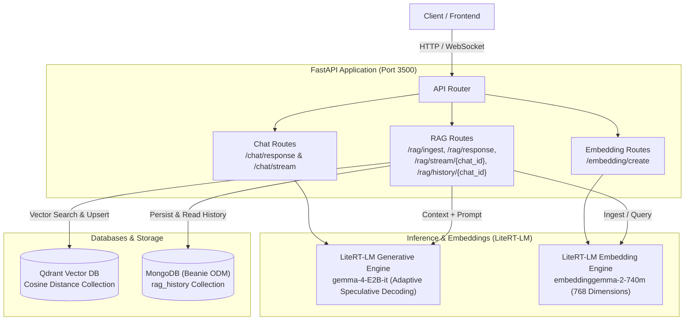

# Gemma RAG AI Server

[](https://www.python.org/)
[](https://fastapi.tiangolo.com/)
[](https://github.com/google-ai-edge/litert)
[](https://qdrant.tech/)
[](https://beanie-odm.dev/)
[](compose.yaml)
[](LICENSE)
[](CONTRIBUTING.md)

A high-performance, self-hosted AI inference, embedding, and Retrieval-Augmented Generation (RAG) server powered by **FastAPI**, Google's **LiteRT-LM** (LiteRT for Language Models) runtime, **Qdrant** vector database, and **MongoDB** (via Beanie ODM). Engineered for low-latency CPU and edge execution, complete on-premises data sovereignty, and real-time bidirectional streaming.

---

## Table of Contents

- [What the Project Does](#what-the-project-does)
  - [Core Capabilities](#core-capabilities)
- [Why the Project Is Useful](#why-the-project-is-useful)
  - [Key Features](#key-features)
  - [Architectural Benefits](#architectural-benefits)
  - [System Flow](#system-flow)
  - [Project Structure](#project-structure)
- [How Users Can Get Started](#how-users-can-get-started)
  - [Prerequisites](#prerequisites)
  - [Environment Configuration](#environment-configuration)
  - [Option A: Quickstart with Docker Compose](#option-a-quickstart-with-docker-compose)
  - [Option B: Manual Local Setup](#option-b-manual-local-setup)
  - [Model Preparation](#model-preparation)
  - [Running the Server](#running-the-server)
  - [Usage Examples](#usage-examples)
    - [1. Health Check](#1-health-check)
    - [2. Synchronous Chat](#2-synchronous-chat)
    - [3. Real-Time Streaming Chat (WebSocket)](#3-real-time-streaming-chat-websocket)
    - [4. Dense Vector Embeddings](#4-dense-vector-embeddings)
    - [5. RAG Document Ingestion](#5-rag-document-ingestion)
    - [6. RAG Contextual Response](#6-rag-contextual-response)
    - [7. RAG Real-Time Streaming Chat (WebSocket)](#7-rag-real-time-streaming-chat-websocket)
    - [8. RAG Chat History Retrieval](#8-rag-chat-history-retrieval)
  - [Interactive API Documentation](#interactive-api-documentation)
  - [Configuration Reference](#configuration-reference)
- [Where Users Can Get Help](#where-users-can-get-help)
- [Who Maintains and Contributes](#who-maintains-and-contributes)
  - [Maintainers](#maintainers)
  - [Contributing](#contributing)
  - [License](#license)

---

## What the Project Does

The **Gemma RAG AI Server** provides an air-gapped, zero-cloud-dependency microservice that hosts and serves Google's Gemma models locally on standard CPU and edge hardware without external API calls or third-party telemetry.

### Core Capabilities

1. **Instruction & Conversational Inference (`gemma-4-E2B-it`)**:
   - Executes instruction-tuned conversational turns and contextual reasoning.
   - Accelerates generation velocity using **adaptive speculative decoding** (`SpeculativeDecodingMode.ADAPTIVE`) with Multi-Token Prediction (MTP) drafting.
   - Supports both synchronous batch responses (`POST /chat/response`) and low-latency token-by-token streaming (`ws://.../chat/stream`).

2. **Dense Vector Embeddings (`embeddinggemma-2-740m`)**:
   - Computes high-quality 768-dimensional geometric dense embeddings (`POST /embedding/create`) on CPU.
   - Powers local similarity search, semantic document retrieval, and downstream classification.

3. **Multi-Tenant Retrieval-Augmented Generation (RAG)**:
   - Chunks incoming document passages and indexes them into **Qdrant** with cosine similarity distance (`POST /rag/ingest`).
   - Partitions knowledge bases by `chat_id` metadata filtering, isolating private context across sessions or users.
   - Performs semantic vector search, injects relevant context into the LLM prompt, and synthesizes grounded answers with source citations (`POST /rag/response` and `ws://.../rag/stream/{chat_id}`).

4. **Persistent Audit & Conversation History**:
   - Automatically records questions, generated responses, and UTC timestamps to **MongoDB** using the **Beanie** asynchronous ODM.
   - Exposes historical queries and responses chronologically by session (`POST /rag/history/{chat_id}`).

---

## Why the Project Is Useful

Building production-ready LLM applications often forces painful compromises between expensive recurring cloud API bills, strict privacy regulations, and unpredictable network latency. Gemma RAG AI Server eliminates these trade-offs by providing an all-in-one local alternative.

### Key Features

- **100% On-Device Privacy & Data Sovereignty**: Operates entirely offline with zero external network requests during inference. Complies naturally with strict data protection requirements (e.g., HIPAA, GDPR, confidential IP, and air-gapped environments).
- **CPU-Optimized via Speculative Decoding**: Uses LiteRT-LM's adaptive speculative decoding mode to maximize token generation throughput on commodity x86_64 and aarch64 CPUs without requiring dedicated GPUs.
- **Enterprise-Grade Vector Storage with Qdrant**: Leverages Qdrant for persistent, high-dimensional vector search with robust metadata filtering.
- **Persistent Session State with MongoDB & Beanie**: Seamlessly logs conversation history and RAG interactions to MongoDB for auditing, analytics, and session recovery.
- **Multi-Tenant Isolation**: Enforces query filters by `chat_id` so multiple users, sessions, or agents can share the same Qdrant collection without data bleeding.
- **Dual WebSocket Streaming Endpoints**: Provides real-time streaming for both raw chat (`/chat/stream`) and grounded RAG responses (`/rag/stream/{chat_id}`).
- **Containerized & Reverse Proxy Ready**: Includes preconfigured [Dockerfile](Dockerfile) and [compose.yaml](compose.yaml) with Nginx Proxy Manager integration for SSL certificate management and reverse proxying.

### Architectural Benefits

| Capability | Gemma RAG AI Server | Cloud LLM APIs |
| :--- | :--- | :--- |
| **Data Privacy** | 100% Local / Zero external telemetry | Transmitted to third-party cloud infrastructure |
| **Recurring Cost** | Free & open-source / Self-hosted | Metered per-token and monthly operational billing |
| **Network Latency** | Sub-millisecond local loopback | Variable internet round-trip & queue latency |
| **Offline Operation** | Fully supported (air-gapped ready) | Not possible |
| **Architecture** | Unified service: LLM + Embeddings + Vector DB + History | Fragmented microservices and external SaaS integrations |

### System Flow



### Project Structure

```text
.
├── .dockerignore            # Docker build ignore patterns
├── .env.example             # Template for required environment variables
├── CONTRIBUTING.md          # Contribution instructions and commit standards
├── Dockerfile               # Multi-stage container definition with model downloads
├── LICENSE                  # MIT License
├── README.md                # Project documentation
├── compose.yaml             # Docker Compose spec (app + Nginx Proxy Manager)
├── requirements.txt         # Project dependencies
├── main.py                  # Server entrypoint and lifespan manager
├── models/                  # LiteRT-LM binary model storage
│   ├── gemma-4-E2B-it.litertlm              # Generative chat model
│   └── embeddinggemma-2-740m.litertlm      # Dense embedding model
├── routes/                  # API endpoint controllers
│   ├── __init__.py          # Router aggregation
│   ├── chat/
│   │   └── chat_routes.py   # HTTP & WebSocket chat handlers
│   ├── embedding/
│   │   └── embedding_routes.py # Text embedding handler
│   ├── health/
│   │   └── health_routes.py # Health check probe
│   └── rag/
│       └── rag_routes.py    # RAG ingestion, query, stream & history
├── schema/                  # Pydantic schemas and Beanie documents
│   ├── __init__.py
│   └── schemas.py           # Request, response, and document models
└── services/                # Backend business logic
    ├── __init__.py
    ├── db/
    │   └── db_service.py    # MongoDB & Beanie ODM lifecycle management
    ├── llm/
    │   └── llm_service.py   # LiteRT-LM engine initialization & inference
    └── rag/
        └── rag_service.py   # Chunking, Qdrant search & context retrieval
```

---

## How Users Can Get Started

### Prerequisites

- **Python**: Version `3.10`, `3.11`, `3.12`, or `3.15` (for manual local setup)
- **Docker & Docker Compose**: If running via containers
- **Memory**: Minimum 8 GB RAM (16 GB recommended for concurrent inference and embeddings)
- **Disk Space**: ~10 GB free space for model weights, virtual environment, and containers
- **Databases**:
  - Running **Qdrant** instance (local Docker container, cloud instance, or remote service)
  - Running **MongoDB** instance (local instance or MongoDB Atlas)

### Environment Configuration

Create your local `.env` configuration from the provided template:

```bash
cp .env.example .env
```

Configure your `.env` variables:

```dotenv
# MongoDB connection URI (e.g. local or MongoDB Atlas)
MONGO_URI=mongodb://localhost:27017/gemma_rag

# Qdrant Vector Database URL and optional credentials
QDRANT_URL=http://localhost:6333
QDRANT_ADMIN=
QDRANT_PASS=
```

---

### Option A: Quickstart with Docker Compose

The repository includes a ready-to-use [compose.yaml](compose.yaml) configured with the application and **Nginx Proxy Manager** (for reverse proxying and automated SSL certificate issuance).

1. **Start the stack**:
   ```bash
   docker compose up -d --build
   ```

2. **Access services**:
   - **Gemma RAG API**: `http://localhost:3500`
   - **Interactive Docs**: `http://localhost:3500/docs`
   - **Nginx Proxy Manager Admin UI**: `http://localhost:81` (Default login: `admin@example.com` / `changeme`)

3. **Stop the stack**:
   ```bash
   docker compose down
   ```

---

### Option B: Manual Local Setup

#### 1. Clone the repository

```bash
git clone https://github.com/masanthimanshu/gemma-rag.git
cd gemma-rag
```

#### 2. Create and activate a virtual environment

```bash
python3 -m venv .venv
source .venv/bin/activate
```

#### 3. Install dependencies

```bash
pip install --upgrade pip
pip install -r requirements.txt
```

---

### Model Preparation

Create the `models/` directory in the project root, navigate into it, and download the compiled LiteRT-LM models from Hugging Face using the `hf` CLI:

```bash
mkdir -p models
cd models

# Download the dense embedding model
hf download litert-community/embeddinggemma-2-740m-litert-lm embeddinggemma-2-740m.litertlm --local-dir "$PWD" --force-download

# Download the generative instruction chat model
hf download litert-community/gemma-4-E2B-it-litert-lm gemma-4-E2B-it.litertlm --local-dir "$PWD" --force-download

# Return to the project root
cd ..
```

> **Note**: If the `hf` command is not available, install it via `pip install huggingface_hub`.

The server expects these exact filenames in `./models/`:
- **Generative Chat Model**: `models/gemma-4-E2B-it.litertlm`
- **Embedding Model**: `models/embeddinggemma-2-740m.litertlm`

---

### Running the Server

Start the server using `main.py`:

```bash
python main.py
```

Or run directly with Uvicorn:

```bash
uvicorn main:app --host 0.0.0.0 --port 3500 --reload
```

During startup, the server automatically:
1. Connects to MongoDB and initializes Beanie ODM with the `RagHistory` document model.
2. Initializes the LiteRT-LM generative and embedding engines with adaptive speculative decoding.
3. Verifies or creates the Qdrant `documents` collection (768 dimensions, cosine distance).

The service is available at `http://localhost:3500`.

---

### Usage Examples

#### 1. Health Check

Verify that the server is online and operational:

```bash
curl -X GET http://localhost:3500/health/
```

**Response**:
```json
{
  "status": 200,
  "message": "It's Working!"
}
```

---

#### 2. Synchronous Chat

Generate an instruction-following response using `POST /chat/response`:

```bash
curl -X POST http://localhost:3500/chat/response \
  -H "Content-Type: application/json" \
  -d '{"message": "Explain speculative decoding in two concise sentences."}'
```

**Response**:
```json
{
  "status": 200,
  "message": "Speculative decoding accelerates LLM generation by having a smaller draft model propose candidate tokens that the larger target model verifies in parallel. This significantly decreases per-token latency while preserving the exact output distribution."
}
```

---

#### 3. Real-Time Streaming Chat (WebSocket)

Connect to `ws://localhost:3500/chat/stream` for real-time token streaming.

**Python Client**:
```python
import asyncio
import websockets

async def stream_chat():
    uri = "ws://localhost:3500/chat/stream"
    async with websockets.connect(uri) as websocket:
        await websocket.send("Explain the benefits of on-device AI inference.")
        while True:
            try:
                chunk = await websocket.recv()
                print(chunk, end="", flush=True)
            except websockets.exceptions.ConnectionClosed:
                break
        print()

asyncio.run(stream_chat())
```

**CLI Testing with `wscat`**:
```bash
# Install wscat: npm install -g wscat
wscat -c ws://localhost:3500/chat/stream
> Tell me three facts about Google Gemma models.
```

---

#### 4. Dense Vector Embeddings

Generate 768-dimensional geometric embeddings for text passages:

```bash
curl -X POST http://localhost:3500/embedding/create \
  -H "Content-Type: application/json" \
  -d '{"message": "Retrieval Augmented Generation with Qdrant and Gemma"}'
```

**Response**:
```json
{
  "status": 200,
  "message": [0.03124, -0.01542, 0.08921, 0.00412, ...]
}
```

---

#### 5. RAG Document Ingestion

Chunk and index document passages into Qdrant partitioned by `chat_id`:

```bash
curl -X POST http://localhost:3500/rag/ingest \
  -H "Content-Type: application/json" \
  -d '{
    "chat_id": "session_alpha",
    "message": "Antigravity is Google DeepMind's agentic engineering platform. It supports autonomous coding swarms, task scheduling, background automation, and specialized developer skills."
  }'
```

**Response**:
```json
{
  "status": 200,
  "message": {
    "ingested_chunks": 1
  }
}
```

---

#### 6. RAG Contextual Response

Ask questions grounded strictly in the ingested context of the matching `chat_id`. The response is automatically saved to MongoDB:

```bash
curl -X POST http://localhost:3500/rag/response \
  -H "Content-Type: application/json" \
  -d '{
    "chat_id": "session_alpha",
    "message": "What capabilities does Antigravity support?"
  }'
```

**Response**:
```json
{
  "status": 200,
  "message": {
    "answer": "Antigravity supports autonomous coding swarms, task scheduling, background automation, and specialized developer skills.",
    "sources": [
      "Antigravity is Google DeepMind's agentic engineering platform. It supports autonomous coding swarms, task scheduling, background automation, and specialized developer skills."
    ]
  }
}
```

---

#### 7. RAG Real-Time Streaming Chat (WebSocket)

Stream RAG answers in real time over WebSocket at `ws://localhost:3500/rag/stream/{chat_id}`. When generation completes, the question and full answer are automatically stored in MongoDB:

```python
import asyncio
import websockets

async def stream_rag():
    chat_id = "session_alpha"
    uri = f"ws://localhost:3500/rag/stream/{chat_id}"
    async with websockets.connect(uri) as websocket:
        await websocket.send("What is Antigravity?")
        while True:
            try:
                chunk = await websocket.recv()
                print(chunk, end="", flush=True)
            except websockets.exceptions.ConnectionClosed:
                break
        print()

asyncio.run(stream_rag())
```

---

#### 8. RAG Chat History Retrieval

Retrieve historical Q&A interactions for a given `chat_id` from MongoDB, ordered chronologically:

```bash
curl -X POST http://localhost:3500/rag/history/session_alpha \
  -H "Content-Type: application/json"
```

**Response**:
```json
{
  "status": 200,
  "message": [
    {
      "_id": "67364b6e5e89a421b8c09a12",
      "chat_id": "session_alpha",
      "question": "What capabilities does Antigravity support?",
      "response": "Antigravity supports autonomous coding swarms, task scheduling, background automation, and specialized developer skills.",
      "created_at": "2026-11-14T21:15:00.123456Z"
    }
  ]
}
```

---

### Interactive API Documentation

When the server is running, explore and test the OpenAPI specifications directly in your browser:

- **Swagger UI**: [http://localhost:3500/docs](http://localhost:3500/docs)
- **ReDoc**: [http://localhost:3500/redoc](http://localhost:3500/redoc)

---

### Configuration Reference

#### Environment Variables

| Variable | Required | Description | Example |
| :--- | :--- | :--- | :--- |
| `MONGO_URI` | **Yes** | Connection string for MongoDB instance | `mongodb://localhost:27017/gemma_rag` |
| `QDRANT_URL` | **Yes** | URL pointing to the Qdrant vector database | `http://localhost:6333` |
| `QDRANT_ADMIN` | No | Username / Admin credential for Qdrant | `admin` |
| `QDRANT_PASS` | No | Password / API key for Qdrant | `your-secret-key` |

#### Runtime Defaults

| Parameter | Default Value | File Location | Description |
| :--- | :--- | :--- | :--- |
| `max_output_tokens` | `1200` | [services/llm/llm_service.py](services/llm/llm_service.py) | Maximum output tokens generated per turn |
| `speculative_config` | `ADAPTIVE` | [services/llm/llm_service.py](services/llm/llm_service.py) | LiteRT-LM speculative decoding mode |
| `llm_model_path` | `./models/gemma-4-E2B-it.litertlm` | [services/llm/llm_service.py](services/llm/llm_service.py) | Generative chat model binary path |
| `embedding_model_path` | `./models/embeddinggemma-2-740m.litertlm` | [services/llm/llm_service.py](services/llm/llm_service.py) | Dense embedding model binary path |
| `chunk_size` | `300` characters | [services/rag/rag_service.py](services/rag/rag_service.py) | Maximum character length per text chunk |
| `chunk_overlap` | `30` characters | [services/rag/rag_service.py](services/rag/rag_service.py) | Character overlap between consecutive chunks |
| `vector_size` | `768` | [services/rag/rag_service.py](services/rag/rag_service.py) | Dimensionality of `embeddinggemma-2-740m` |
| `distance_metric` | `COSINE` | [services/rag/rag_service.py](services/rag/rag_service.py) | Qdrant vector similarity metric |
| `host` | `0.0.0.0` | [main.py](main.py) | Host interface network binding |
| `port` | `3500` | [main.py](main.py) | Web server port |

---

## Where Users Can Get Help

- **Issues & Bug Reports**: Submit an issue on [GitHub Issues](https://github.com/masanthimanshu/gemma-rag/issues).
- **FastAPI Documentation**: Consult the [FastAPI Documentation](https://fastapi.tiangolo.com/) for routing, WebSockets, and lifespan patterns.
- **Google LiteRT**: Learn more about running Google models locally via [Google AI Edge LiteRT](https://github.com/google-ai-edge/litert).
- **Qdrant Vector Database**: Explore vector indexing and search filters at [qdrant.tech/documentation](https://qdrant.tech/documentation/).
- **Beanie ODM**: Review async document schemas and queries at [beanie-odm.dev](https://beanie-odm.dev/).

---

## Who Maintains and Contributes

### Maintainers

- **Himanshu Masant** ([@masanthimanshu](https://github.com/masanthimanshu)) — [masanthimanshu@gmail.com](mailto:masanthimanshu@gmail.com)

### Contributing

Contributions, feature proposals, and bug reports are welcome! Please consult the [CONTRIBUTING.md](CONTRIBUTING.md) guide for details on development workflow, branch naming conventions, and pull request standards.

### License

This project is licensed under the MIT License. See the [LICENSE](LICENSE) file for the full text.
