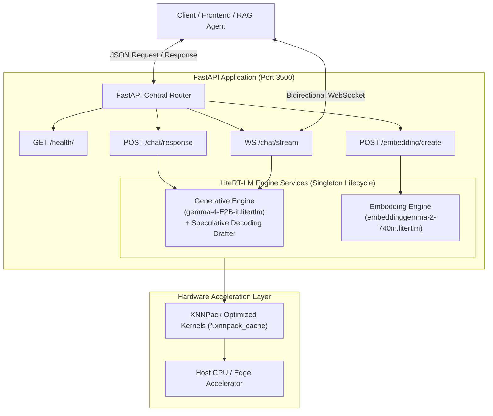
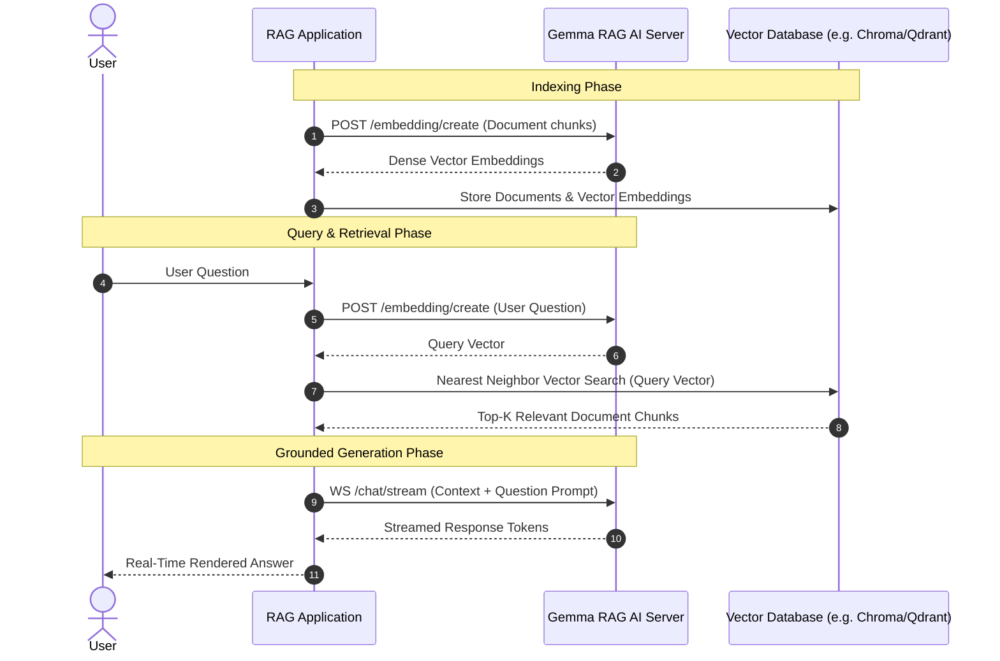

# Gemma RAG AI Server

[](https://www.python.org/)
[](https://fastapi.tiangolo.com/)
[](https://github.com/google-ai-edge/litert)
[](https://www.uvicorn.org/)
[](LICENSE)
[](CONTRIBUTING.md)

A high-performance, lightweight, self-hosted AI inference and embedding server built with **FastAPI** and Google's **LiteRT-LM** (LiteRT for Language Models) runtime. Specially engineered for low-latency Retrieval-Augmented Generation (RAG) pipelines, on-device reasoning, and interactive token-by-token WebSocket chat streaming.

---

## Table of Contents

- [What the Project Does](#what-the-project-does)
- [Why the Project Is Useful](#why-the-project-is-useful)
  - [Key Features & Highlights](#key-features--highlights)
  - [Performance & Architectural Advantages](#performance--architectural-advantages)
- [System Architecture](#system-architecture)
  - [High-Level Dataflow](#high-level-dataflow)
  - [Repository Layout](#repository-layout)
- [How Users Can Get Started](#how-users-can-get-started)
  - [System Requirements](#system-requirements)
  - [Installation](#installation)
  - [Model Acquisition & Preparation](#model-acquisition--preparation)
  - [Running the Server](#running-the-server)
  - [Production Deployment (Systemd)](#production-deployment-systemd)
- [Usage Examples](#usage-examples)
  - [1. Health Check](#1-health-check)
  - [2. Synchronous Chat Completion](#2-synchronous-chat-completion)
  - [3. Real-Time Streaming Chat (WebSocket)](#3-real-time-streaming-chat-websocket)
    - [Python Streaming Client](#python-streaming-client)
    - [Browser / JavaScript WebSocket Client](#browser--javascript-websocket-client)
    - [Terminal Streaming with wscat](#terminal-streaming-with-wscat)
  - [4. Dense Text Embeddings](#4-dense-text-embeddings)
    - [Python RAG Similarity Example](#python-rag-similarity-example)
  - [Interactive API Documentation](#interactive-api-documentation)
- [RAG Integration Workflow](#rag-integration-workflow)
- [Configuration Reference](#configuration-reference)
- [Where Users Can Get Help](#where-users-can-get-help)
- [Who Maintains and Contributes](#who-maintains-and-contributes)
  - [Maintainer](#maintainer)
  - [Contributing](#contributing)
  - [License](#license)

---

## What the Project Does

The **Gemma RAG AI Server** provides an air-gapped, zero-cloud-dependency API microservice serving Google's state-of-the-art Gemma models locally on CPU or edge hardware. 

The server simultaneously manages two dedicated machine learning engines within a single unified process:

1. **Instruction & Generative Chat Engine (`gemma-4-E2B-it`)**:
   - Executes instruction-tuned conversational inference and contextual question answering.
   - Employs **adaptive speculative decoding** to dramatically accelerate token generation velocity.
   - Delivers both synchronous batch answers (`POST /chat/response`) and low-latency streaming (`ws://.../chat/stream`).

2. **Dense Vector Embedding Engine (`embeddinggemma-2-740m`)**:
   - Transforms natural language queries, document chunks, and passage texts into dense geometric vector embeddings.
   - Serves as the vectorization backbone for local semantic search, retrieval indexing, and RAG knowledge bases (`POST /embedding/create`).

---

## Why the Project Is Useful

Building production-ready RAG applications often entails balancing expensive cloud LLM API costs, strict data privacy regulations, and unpredictable network latency. Gemma RAG AI Server solves this by delivering an optimized, completely self-hosted local stack.

### Key Features & Highlights

- **100% On-Device Privacy & Data Sovereignty**: Operates entirely offline with zero telemetry or third-party API calls. Ideal for confidential documents, HIPAA/GDPR sensitive contexts, and air-gapped environments.
- **Speculative Decoding Acceleration**: Configured with LiteRT-LM's multi-token prediction (MTP) drafting and adaptive speculative decoding mode (`ADAPTIVE`), reducing latency per token on CPU execution.
- **Real-Time Token Streaming**: Built-in persistent WebSocket server emits generated tokens in real time with minimal per-chunk overhead.
- **Unified Generative + Embedding Architecture**: Eliminates the operational complexity of running separate servers or Docker containers for generation versus embeddings.
- **XNNPack Kernel Compilation & Persistent Cache**: Automatically compiles and persists optimized CPU instruction kernels on the first run (`.xnnpack_cache`), ensuring fast cold starts on subsequent boots.
- **Async Lifespan Management**: Gracefully initializes LiteRT-LM runtime memory pools during application startup and cleanly deallocates model handles during shutdown.

### Performance & Architectural Advantages

| Feature | Gemma RAG AI Server | Cloud LLM APIs | Standard Python PyTorch Server |
| :--- | :--- | :--- | :--- |
| **Privacy / Telemetry** | 100% Local / Zero Egress | Data sent across internet | Local |
| **Operational Cost** | \$0 recurring compute fees | Metered per 1k tokens | Hardware cost |
| **Runtime Overhead** | Lightweight compiled C++ LiteRT | Network transit latency | Heavy Python/PyTorch memory footprint |
| **Streaming Protocol** | Native WebSocket | Server-Sent Events (SSE) / HTTP | Custom / SSE |
| **Token Acceleration** | Adaptive Speculative Decoding | Dependent on provider | Requires complex vLLM / TensorRT setup |

---

## System Architecture

### High-Level Dataflow



### Repository Layout

```text
ai-server/
├── main.py                          # Server entrypoint, lifespan context, and Uvicorn runner
├── requirements.txt                 # Pinned dependencies (FastAPI, LiteRT-LM, Uvicorn, etc.)
├── models/                          # Model binaries and auto-generated XNNPack kernel caches
│   ├── gemma-4-E2B-it.litertlm      # Generative conversational model
│   └── embeddinggemma-2-740m.litertlm # Multimodal/text dense embedding model
├── routes/                          # Modular API routing hierarchy
│   ├── __init__.py                  # Aggregates sub-routers into api_router
│   ├── chat/
│   │   └── chat_routes.py           # Sync chat endpoint & WebSocket streaming handler
│   ├── embedding/
│   │   └── embedding_routes.py      # Vector embedding generation endpoint
│   └── health/
│       └── health_routes.py         # Service liveness check endpoint
├── schema/                          # Data contracts and serialization schemas
│   ├── __init__.py                  # Package exports
│   └── schemas.py                   # Pydantic schemas (ChatRequest, ResponseModel)
└── services/                        # Core service and engine orchestration
    ├── __init__.py                  # Package interface exposing the llm service
    └── llm/
        └── llm_service.py           # LiteRT-LM engine lifecycle, streaming, & embeddings
```

---

## How Users Can Get Started

### System Requirements

- **Python**: Version 3.10 or later (compatible with Python 3.10 – 3.15)
- **Operating System**: Linux (Ubuntu 20.04+, Amazon Linux 2023, Debian 11+), macOS (Apple Silicon or Intel), or Windows via WSL2
- **Memory**: Minimum 8 GB RAM (16 GB RAM recommended for optimal throughput during concurrent generation and embedding)
- **Storage**: At least 10 GB free disk space to store model binaries and compiled kernel cache files

### Installation

1. **Clone the repository:**

   ```bash
   git clone https://github.com/masanthimanshu/gemma-rag.git
   cd gemma-rag
   ```

2. **Create and activate a virtual environment:**

   ```bash
   python3 -m venv .venv
   source .venv/bin/activate
   ```

3. **Install dependencies:**

   ```bash
   pip install --upgrade pip
   pip install -r requirements.txt
   ```

### Model Acquisition & Preparation

The server requires pre-compiled `.litertlm` models placed in the `models/` directory.

1. Create the `models/` folder:

   ```bash
   mkdir -p models
   ```

2. Place the following files in `models/`:
   - `models/gemma-4-E2B-it.litertlm` (Instruction chat model)
   - `models/embeddinggemma-2-740m.litertlm` (Embedding model)

> [!NOTE]
> On the very first request to either engine, LiteRT-LM compiles hardware-optimized CPU kernels and saves them as `*.xnnpack_cache` in the `models/` directory. This initial compilation step takes a few moments, after which subsequent startups and requests run at peak execution speed.

### Running the Server

Start the application with Python:

```bash
python main.py
```

Or run directly through the Uvicorn CLI for fine-grained worker and reload control:

```bash
uvicorn main:app --host 0.0.0.0 --port 3500 --reload
```

The server initializes and binds to `http://0.0.0.0:3500`.

### Production Deployment (Systemd)

To run the server as a persistent background daemon on a Linux host, create a systemd service file:

```ini
# /etc/systemd/system/gemma-rag.service
[Unit]
Description=Gemma RAG AI Server
After=network.target

[Service]
User=ec2-user
WorkingDirectory=/home/ec2-user/ai-server
ExecStart=/home/ec2-user/ai-server/.venv/bin/uvicorn main:app --host 0.0.0.0 --port 3500
Restart=always
RestartSec=5
EnvironmentFile=/home/ec2-user/ai-server/.env

[Install]
WantedBy=multi-user.target
```

Enable and start the service:

```bash
sudo systemctl daemon-reload
sudo systemctl enable --now gemma-rag
```

---

## Usage Examples

### 1. Health Check

Quickly verify that the server is alive and operational.

- **Method**: `GET`
- **Path**: `/health/`

```bash
curl -X GET http://localhost:3500/health/
```

**Response**:
```json
{
  "status": 200,
  "message": "It's Working!"
}
```

---

### 2. Synchronous Chat Completion

Send a single prompt and receive the full completion upon generation.

- **Method**: `POST`
- **Path**: `/chat/response`
- **Header**: `Content-Type: application/json`

```bash
curl -X POST http://localhost:3500/chat/response \
  -H "Content-Type: application/json" \
  -d '{"message": "Explain Retrieval-Augmented Generation in two sentences."}'
```

**Response**:
```json
{
  "status": 200,
  "message": "Retrieval-Augmented Generation (RAG) enhances language models by fetching relevant external knowledge from an external database before generating an answer. This grounds the model's response in accurate, up-to-date facts while reducing hallucinations."
}
```

---

### 3. Real-Time Streaming Chat (WebSocket)

Connect over WebSocket for token-by-token streaming, ideal for responsive web and desktop chat interfaces.

- **URL**: `ws://localhost:3500/chat/stream`
- **Client Transmission**: Send the query string directly as text.
- **Server Transmission**: Streams individual JSON events containing token chunks:
  ```json
  {"type": "response", "content": "..."}
  ```

#### Python Streaming Client

```python
import asyncio
import json
import websockets

async def stream_chat(prompt: str):
    uri = "ws://localhost:3500/chat/stream"
    async with websockets.connect(uri) as websocket:
        # Send text prompt
        await websocket.send(prompt)
        
        # Stream response chunks
        while True:
            try:
                raw_event = await websocket.recv()
                event = json.loads(raw_event)
                if event.get("type") == "response":
                    print(event["content"], end="", flush=True)
            except websockets.exceptions.ConnectionClosed:
                break
    print()

if __name__ == "__main__":
    asyncio.run(stream_chat("Write a Python function to compute Fibonacci numbers."))
```

#### Browser / JavaScript WebSocket Client

```javascript
const socket = new WebSocket('ws://localhost:3500/chat/stream');

socket.addEventListener('open', () => {
  socket.send('Summarize the benefits of on-device AI inference.');
});

socket.addEventListener('message', (event) => {
  const data = JSON.parse(event.data);
  if (data.type === 'response') {
    process.stdout.write(data.content); // Or append to DOM
  }
});
```

#### Terminal Streaming with wscat

You can also test the streaming endpoint using `wscat`:

```bash
npx wscat -c ws://localhost:3500/chat/stream
# Once connected, type your prompt and press Enter:
> Tell me a short story about an astronaut.
```

---

### 4. Dense Text Embeddings

Generate high-dimensional vector representations for queries, document passages, or knowledge base chunks.

- **Method**: `POST`
- **Path**: `/embedding/create`
- **Header**: `Content-Type: application/json`

```bash
curl -X POST http://localhost:3500/embedding/create \
  -H "Content-Type: application/json" \
  -d '{"message": "Neural search and semantic similarity"}'
```

**Response**:
```json
{
  "status": 200,
  "message": [
    0.01523,
    -0.03841,
    0.08192,
    -0.00427,
    0.04518
  ]
}
```

#### Python RAG Similarity Example

Compute cosine similarity between two sentences using the embedding endpoint:

```python
import numpy as np
import requests

def get_embedding(text: str) -> np.ndarray:
    res = requests.post(
        "http://localhost:3500/embedding/create",
        json={"message": text}
    )
    res.raise_for_status()
    return np.array(res.json()["message"])

# Embed query and document
query_vec = get_embedding("How do I reset my account password?")
doc_vec_match = get_embedding("To change your login credentials, go to Settings > Security.")
doc_vec_unrelated = get_embedding("The recipe calls for two cups of flour and butter.")

def cosine_similarity(a: np.ndarray, b: np.ndarray) -> float:
    return float(np.dot(a, b) / (np.linalg.norm(a) * np.linalg.norm(b)))

print(f"Similarity (Matching Doc):   {cosine_similarity(query_vec, doc_vec_match):.4f}")
print(f"Similarity (Unrelated Doc):  {cosine_similarity(query_vec, doc_vec_unrelated):.4f}")
```

---

### Interactive API Documentation

FastAPI automatically generates interactive OpenAPI documentation accessible via any web browser when the server is running:

- **Swagger UI**: [http://localhost:3500/docs](http://localhost:3500/docs) (Interactive endpoint testing)
- **ReDoc**: [http://localhost:3500/redoc](http://localhost:3500/redoc) (Clean, structured reference documentation)

---

## RAG Integration Workflow

The following pattern illustrates how this server integrates into a complete Retrieval-Augmented Generation pipeline:



---

## Configuration Reference

Key engine and network configurations can be customized in [`services/llm/llm_service.py`](services/llm/llm_service.py) and [`main.py`](main.py):

| Parameter | Default Value | File Location | Description |
| :--- | :--- | :--- | :--- |
| `max_output_tokens` | `600` | [`services/llm/llm_service.py`](services/llm/llm_service.py) | Maximum output tokens generated per conversation turn. |
| `speculative_config.mode` | `ADAPTIVE` | [`services/llm/llm_service.py`](services/llm/llm_service.py) | LiteRT-LM speculative decoding mode (`ADAPTIVE`, `STATIC`, or disabled). |
| `llm_model_path` | `./models/gemma-4-E2B-it.litertlm` | [`services/llm/llm_service.py`](services/llm/llm_service.py) | Filesystem path to the primary generative model binary. |
| `embedding_model_path` | `./models/embeddinggemma-2-740m.litertlm` | [`services/llm/llm_service.py`](services/llm/llm_service.py) | Filesystem path to the dense embedding model binary. |
| `port` | `3500` | [`main.py`](main.py) | Network port for the FastAPI/Uvicorn server. |
| `host` | `0.0.0.0` | [`main.py`](main.py) | Network host interface binding address. |
| `reload` | `True` | [`main.py`](main.py) | Hot-reloading mode for development (`False` in production). |

---

## Where Users Can Get Help

- **Issue Tracker**: Report bugs, ask questions, or request new features on [GitHub Issues](https://github.com/masanthimanshu/gemma-rag/issues).
- **Interactive Documentation**: Test and inspect endpoints directly on your running instance at `http://localhost:3500/docs`.
- **FastAPI Documentation**: Comprehensive guidance on FastAPI routing, middleware, and deployment at [fastapi.tiangolo.com](https://fastapi.tiangolo.com/).
- **Google LiteRT**: Learn more about Google's edge inference runtime, model compilation, and hardware optimization at [github.com/google-ai-edge/litert](https://github.com/google-ai-edge/litert).

---

## Who Maintains and Contributes

### Maintainer

- **Himanshu Masant** ([@masanthimanshu](https://github.com/masanthimanshu)) — [masanthimanshu@gmail.com](mailto:masanthimanshu@gmail.com)

### Contributing

We welcome contributions! Please review [CONTRIBUTING.md](CONTRIBUTING.md) for guidelines on development environment setup, branch naming conventions, commit formats, and the pull request submission process.

### License

This project is licensed under the MIT License — see the [LICENSE](LICENSE) file for complete terms and copyright notices.
