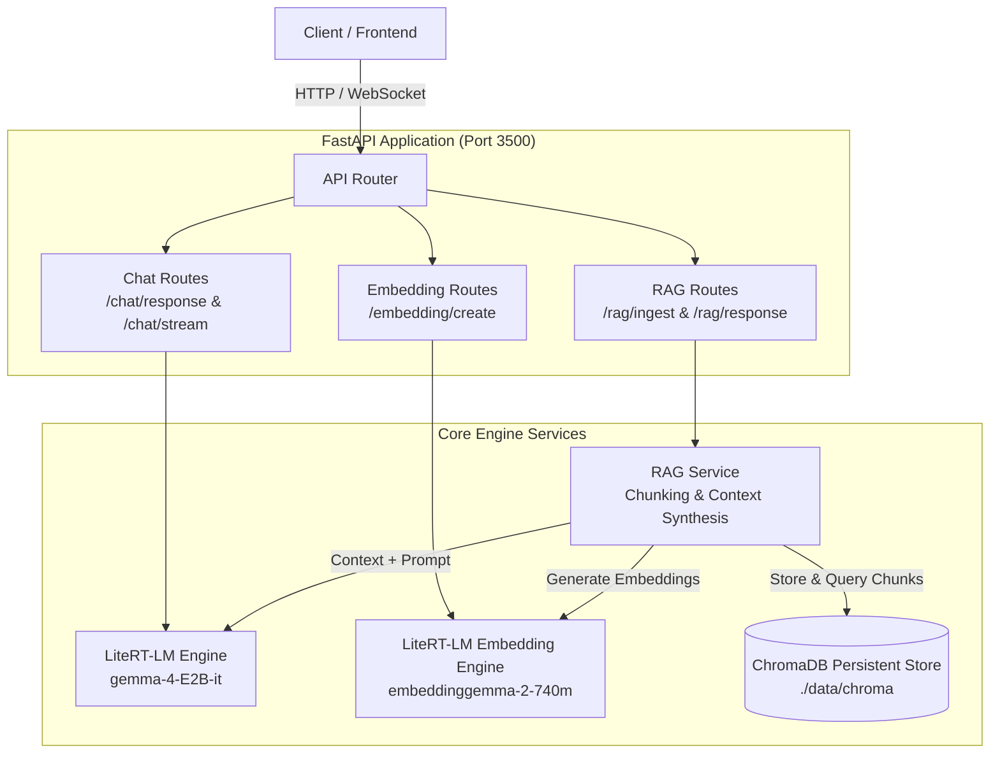

# Gemma RAG AI Server

[](https://www.python.org/)
[](https://fastapi.tiangolo.com/)
[](https://github.com/google-ai-edge/litert)
[](https://www.trychroma.com/)
[](LICENSE)
[](CONTRIBUTING.md)

A high-performance, lightweight, self-hosted AI inference, embedding, and Retrieval-Augmented Generation (RAG) server built with **FastAPI**, Google's **LiteRT-LM** (LiteRT for Language Models) runtime, and **ChromaDB**. Designed for low-latency CPU and edge execution, complete data sovereignty, and real-time streaming chat.

---

## Table of Contents

- [What the Project Does](#what-the-project-does)
- [Why the Project Is Useful](#why-the-project-is-useful)
  - [Key Features](#key-features)
  - [Architectural Benefits](#architectural-benefits)
- [Architecture Overview](#architecture-overview)
  - [System Flow](#system-flow)
  - [Project Structure](#project-structure)
- [How Users Can Get Started](#how-users-can-get-started)
  - [Prerequisites](#prerequisites)
  - [Installation](#installation)
  - [Model Preparation](#model-preparation)
  - [Running the Server](#running-the-server)
- [Usage Examples](#usage-examples)
  - [1. Health Check](#1-health-check)
  - [2. Synchronous Chat](#2-synchronous-chat)
  - [3. Real-Time Streaming Chat (WebSocket)](#3-real-time-streaming-chat-websocket)
  - [4. Vector Embeddings](#4-vector-embeddings)
  - [5. RAG Document Ingestion & Query](#5-rag-document-ingestion--query)
  - [Interactive API Documentation](#interactive-api-documentation)
- [Configuration](#configuration)
- [Where Users Can Get Help](#where-users-can-get-help)
- [Who Maintains and Contributes](#who-maintains-and-contributes)
  - [Maintainers](#maintainers)
  - [Contributing](#contributing)
  - [License](#license)

---

## What the Project Does

The **Gemma RAG AI Server** provides an air-gapped, zero-cloud-dependency API microservice serving Google's Gemma models locally on commodity CPU and edge hardware.

The server hosts three core capabilities in a single unified process:

1. **Instruction & Conversational Inference (`gemma-4-E2B-it`)**:
   - Executes instruction-tuned conversational turns and contextual reasoning.
   - Leverages **adaptive speculative decoding** to maximize token generation velocity.
   - Provides both standard batch responses (`POST /chat/response`) and low-latency token streaming (`ws://.../chat/stream`).

2. **Dense Vector Embeddings (`embeddinggemma-2-740m`)**:
   - Transforms queries and document passages into high-dimensional geometric vector embeddings (`POST /embedding/create`).
   - Powers local similarity matching and semantic retrieval.

3. **Built-in Retrieval-Augmented Generation (RAG) with ChromaDB**:
   - Chunks and indexes documents on disk with persistent vector storage (`POST /rag/ingest`).
   - Supports multi-tenant metadata filtering by user identifier.
   - Retrieves top matching context and synthesizes grounded answers with citations (`POST /rag/response`).

---

## Why the Project Is Useful

Building production-ready AI applications often forces compromises between expensive cloud API fees, stringent data privacy compliance, and unpredictable network latency. Gemma RAG AI Server eliminates these trade-offs by providing an all-in-one local solution.

### Key Features

- **100% On-Device Privacy & Data Sovereignty**: Operates entirely offline with zero external network requests during inference. Ideal for sensitive, proprietary, or regulated data (e.g., HIPAA, GDPR, air-gapped environments).
- **Fast CPU Inference via Speculative Decoding**: Utilizes LiteRT-LM's multi-token prediction (MTP) drafting and adaptive speculative decoding (`SpeculativeDecodingMode.ADAPTIVE`) for rapid token delivery on standard CPU environments.
- **Integrated Persistent Vector Database**: Embeds ChromaDB directly into the service process for zero-configuration persistent storage under `./data/chroma`.
- **Multi-Tenant User Isolation**: Ingests and queries document collections filtered by user ID (`where={"user": user}`), enabling isolated workspaces across clients.
- **Bi-Directional WebSocket Streaming**: Emits tokens in real-time as they are decoded, eliminating perceived latency for conversational interfaces.
- **Asynchronous Lifespan Management**: Manages engine resources with FastAPI lifespan handlers, guaranteeing clean startup, model caching, and graceful shutdown.

### Architectural Benefits

| Capability | Gemma RAG AI Server | Cloud LLM APIs |
| :--- | :--- | :--- |
| **Data Privacy** | 100% Local / Zero telemetry | Data transmitted to third parties |
| **Recurring Costs** | \$0 / Self-hosted | Per-token / monthly billing |
| **Network Latency** | Sub-millisecond local loopback | Dependent on internet & cloud load |
| **Offline Operation** | Fully supported | Impossible |
| **All-in-One RAG** | Built-in Embeddings + Chroma + LLM | Multiple disparate microservices |

---

## Architecture Overview

### System Flow



### Project Structure

```text
.
├── data/
│   └── chroma/                 # Local ChromaDB persistent vector storage
├── models/
│   ├── gemma-4-E2B-it.litertlm              # Generative chat model
│   └── embeddinggemma-2-740m.litertlm      # Dense embedding model
├── routes/
│   ├── __init__.py             # Unified APIRouter aggregator
│   ├── chat/
│   │   └── chat_routes.py      # HTTP & WebSocket chat endpoints
│   ├── embedding/
│   │   └── embedding_routes.py # Text embedding endpoint
│   ├── health/
│   │   └── health_routes.py    # Health check endpoint
│   └── rag/
│       └── rag_routes.py       # Ingestion and RAG question answering
├── schema/
│   ├── __init__.py
│   └── schemas.py              # Pydantic request & response models
├── services/
│   ├── __init__.py
│   ├── llm/
│   │   └── llm_service.py      # LiteRT-LM initialization & inference
│   └── rag/
│       └── rag_service.py      # Text chunking, ChromaDB storage & search
├── CONTRIBUTING.md             # Developer contribution guidelines
├── LICENSE                     # MIT License terms
├── main.py                     # Server entrypoint and lifespan manager
└── requirements.txt            # Python dependencies
```

---

## How Users Can Get Started

### Prerequisites

- **Python**: Version `3.10`, `3.11`, `3.12`, or `3.15`
- **Operating System**: Linux (Ubuntu, Debian, Amazon Linux, RHEL), macOS, or Windows WSL2
- **Memory**: Minimum 8 GB RAM (16 GB recommended for concurrent inference and embeddings)
- **Disk Space**: ~10 GB free space for models, dependencies, and vector database

### Installation

1. **Clone the repository**:
   ```bash
   git clone https://github.com/masanthimanshu/gemma-rag.git
   cd gemma-rag
   ```

2. **Create and activate a virtual environment**:
   ```bash
   python3 -m venv .venv
   source .venv/bin/activate
   ```

3. **Install dependencies**:
   ```bash
   pip install --upgrade pip
   pip install -r requirements.txt
   ```

### Model Preparation

Place your compiled `.litertlm` models in the `./models/` directory:

```bash
mkdir -p models
```

The server expects the following filenames by default:
- **Generative Chat Model**: `models/gemma-4-E2B-it.litertlm`
- **Embedding Model**: `models/embeddinggemma-2-740m.litertlm`

> LiteRT-LM models can be obtained from the Google AI Edge repository or Kaggle/HuggingFace model hubs supporting LiteRT formats.

### Running the Server

Start the application with Uvicorn:

```bash
python main.py
```

Or run Uvicorn directly from the command line:

```bash
uvicorn main:app --host 0.0.0.0 --port 3500 --reload
```

The server will initialize the LiteRT-LM engines during startup and be ready to accept requests at `http://localhost:3500`.

---

## Usage Examples

### 1. Health Check

Verify that the server is online and operational:

```bash
curl -X GET http://localhost:3500/health/
```

**Response**:
```json
{
  "status": 200,
  "message": "It's Working!"
}
```

---

### 2. Synchronous Chat

Generate an instruction-following response:

```bash
curl -X POST http://localhost:3500/chat/response \
  -H "Content-Type: application/json" \
  -d '{"message": "Explain the concept of speculative decoding in two sentences."}'
```

**Response**:
```json
{
  "status": 200,
  "message": "Speculative decoding accelerates LLM inference by using a smaller draft model to generate candidate tokens in parallel, which are then verified in one pass by the target model. This reduces execution latency without degrading output quality."
}
```

---

### 3. Real-Time Streaming Chat (WebSocket)

Connect to the WebSocket endpoint `ws://localhost:3500/chat/stream` for real-time token streaming.

#### Python Client

```python
import asyncio
import websockets

async def stream_chat():
    uri = "ws://localhost:3500/chat/stream"
    async with websockets.connect(uri) as websocket:
        await websocket.send("Write a short poem about local edge computing.")
        while True:
            try:
                chunk = await websocket.recv()
                print(chunk, end="", flush=True)
            except websockets.exceptions.ConnectionClosed:
                break
        print()

asyncio.run(stream_chat())
```

#### Terminal Testing with `wscat`

```bash
# Install wscat if needed: npm install -g wscat
wscat -c ws://localhost:3500/chat/stream
> Tell me three facts about LiteRT.
```

---

### 4. Vector Embeddings

Generate dense vector embeddings for search, ranking, or clustering:

```bash
curl -X POST http://localhost:3500/embedding/create \
  -H "Content-Type: application/json" \
  -d '{"message": "Retrieval Augmented Generation with ChromaDB"}'
```

**Response**:
```json
{
  "status": 200,
  "message": [0.0312, -0.0154, 0.0892, 0.0041, ...]
}
```

---

### 5. RAG Document Ingestion & Query

The server includes a complete end-to-end RAG system with automatic text chunking and persistent ChromaDB storage.

#### Step 1: Ingest Document Content

Ingest raw text associated with a specific user:

```bash
curl -X POST http://localhost:3500/rag/ingest \
  -H "Content-Type: application/json" \
  -d '{
    "user": "alice",
    "message": "Antigravity is Google DeepMind's agentic engineering platform. It supports autonomous coding swarms, task scheduling, and customized developer tools."
  }'
```

**Response**:
```json
{
  "status": 200,
  "message": {
    "ingested_chunks": 1
  }
}
```

#### Step 2: Query with Contextual Answer Generation

Ask a question filtered to that user's knowledge base:

```bash
curl -X POST http://localhost:3500/rag/response \
  -H "Content-Type: application/json" \
  -d '{
    "user": "alice",
    "message": "What is Antigravity?"
  }'
```

**Response**:
```json
{
  "status": 200,
  "message": {
    "answer": "Antigravity is an agentic engineering platform developed by Google DeepMind that supports autonomous coding swarms, task scheduling, and customized developer tools.",
    "sources": [
      "Antigravity is Google DeepMind's agentic engineering platform. It supports autonomous coding swarms, task scheduling, and customized developer tools."
    ]
  }
}
```

---

### Interactive API Documentation

When the server is running, explore and test all endpoints interactively:

- **Swagger UI**: [http://localhost:3500/docs](http://localhost:3500/docs)
- **ReDoc**: [http://localhost:3500/redoc](http://localhost:3500/redoc)

---

## Configuration

Default paths, token limits, and runtime modes are configured in the source code:

| Parameter | Default Value | File Location | Description |
| :--- | :--- | :--- | :--- |
| `max_output_tokens` | `1200` | [`services/llm/llm_service.py`](services/llm/llm_service.py) | Maximum output tokens generated per conversation turn |
| `speculative_config` | `ADAPTIVE` | [`services/llm/llm_service.py`](services/llm/llm_service.py) | LiteRT-LM speculative decoding optimization mode |
| `llm_model_path` | `./models/gemma-4-E2B-it.litertlm` | [`services/llm/llm_service.py`](services/llm/llm_service.py) | Filesystem path to generative LLM binary |
| `embedding_model_path` | `./models/embeddinggemma-2-740m.litertlm` | [`services/llm/llm_service.py`](services/llm/llm_service.py) | Filesystem path to embedding model binary |
| `chroma_path` | `./data/chroma` | [`services/rag/rag_service.py`](services/rag/rag_service.py) | Directory for persistent ChromaDB storage |
| `chunk_size` | `300` | [`services/rag/rag_service.py`](services/rag/rag_service.py) | Character size per RAG document chunk |
| `chunk_overlap` | `30` | [`services/rag/rag_service.py`](services/rag/rag_service.py) | Character overlap between consecutive chunks |
| `host` | `0.0.0.0` | [`main.py`](main.py) | Network interface binding address |
| `port` | `3500` | [`main.py`](main.py) | Port number for FastAPI / Uvicorn |

---

## Where Users Can Get Help

- **GitHub Issues**: Submit bug reports and feature requests via [GitHub Issues](https://github.com/masanthimanshu/gemma-rag/issues).
- **FastAPI Documentation**: Reference routing, request validation, and deployment patterns at [fastapi.tiangolo.com](https://fastapi.tiangolo.com/).
- **LiteRT-LM Guide**: Learn more about LiteRT inference runtimes and model optimizations at [github.com/google-ai-edge/litert](https://github.com/google-ai-edge/litert).
- **ChromaDB Documentation**: Explore vector storage queries and filtering at [docs.trychroma.com](https://docs.trychroma.com/).

---

## Who Maintains and Contributes

### Maintainers

- **Himanshu Masant** ([@masanthimanshu](https://github.com/masanthimanshu)) — [masanthimanshu@gmail.com](mailto:masanthimanshu@gmail.com)

### Contributing

Contributions, feature proposals, and bug fixes are welcome! Please see the [CONTRIBUTING.md](CONTRIBUTING.md) guide for details on our workflow, branch conventions, and pull request process.

### License

This project is licensed under the MIT License. See the [LICENSE](LICENSE) file for complete details.
